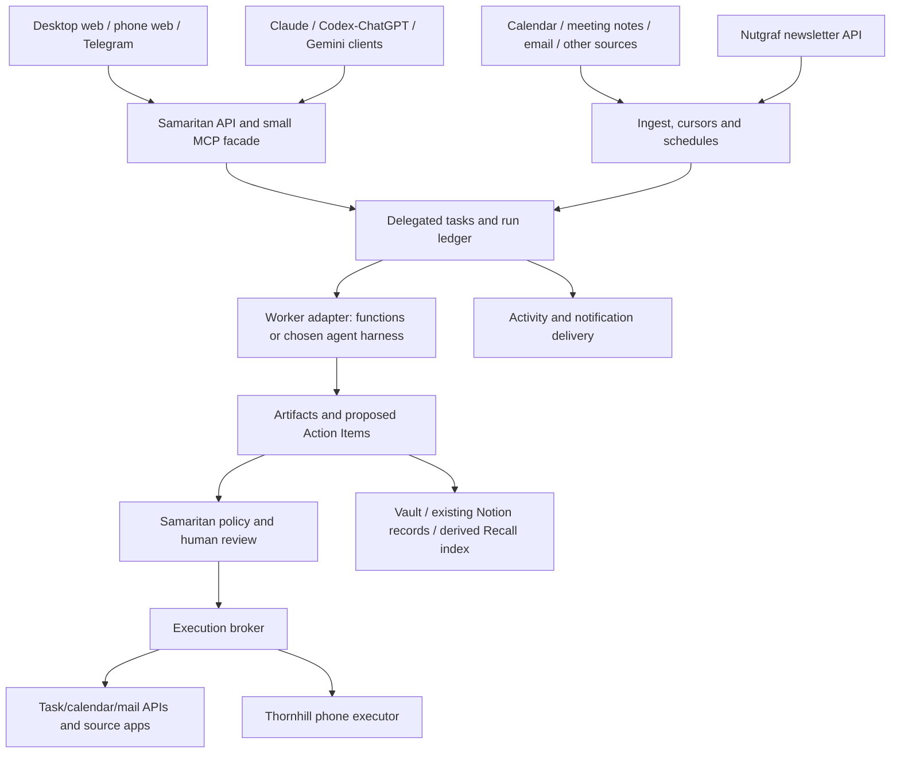

# Codex, round 1

Independent research completed 2026-10-20. Sources checked that day. Peer round reports have not been read. Sandip's direct answers are in [USER-ANSWERS.md](USER-ANSWERS.md): start with meeting context, notes and follow-up tasks; use the current Mac initially.

## Recommendation

**Extend Samaritan into the command centre. Keep its Action Center, policy, audit and knowledge stores. Use an existing agent harness for delegated work rather than inventing a tool-use loop.** My initial implementation choice is the Claude Agent SDK behind a small runner interface, alongside Samaritan's existing deterministic capabilities. OpenClaw is the strongest alternative to trial before committing to that runtime choice; Hermes is also credible. Neither should become a second independent approval system or second brain. Keep Thornhill as the phone executor and Nutgraf as the newsletter service. Ship one dependable meeting workflow before connecting the rest of your life.

This recommendation is based on the inspected implementation and your chosen first workflow, not a claim that a custom app is universally better. There are real costs to maintaining Samaritan's missing scheduling and recovery machinery. An off-the-shelf runtime that demonstrably removes those costs can change D1 without changing the rest of this architecture.

## Decision table

| ID | Position | Confidence | Reason |
|---|---|---|---|
| D1 Agent runtime | Extend Samaritan's run boundary; use Claude Agent SDK for tasks requiring tools, existing functions for extraction/rules. Trial OpenClaw before a permanent runtime decision. | Medium | Reuses the TypeScript system; avoids writing a cognitive harness. Operational recovery still needs work. |
| D2 Command centre | Extend the existing React Action Center with delegated tasks, runs, activity and controls. | High | A source-backed dashboard already exists; the missing task and run model matters more than another visual shell. |
| D3 Second brain | Preserve current vault/Notion/source-app ownership; SQLite owns operational records; generated artifacts have stable paths and an index. Recall is derived. | High | Prevents multiple assistants maintaining incompatible copies of facts and tasks. |
| D4 Cross-assistant context | One small Samaritan MCP facade plus concise, explicit context pointers in each client's supported configuration. | High | Shared tools and artifacts are reliable integration boundaries; model memories are not a shared database. |
| D5 Surfaces | Same backend for desktop and responsive phone web UI, with Telegram for capture, short questions and notifications. | High | Answering on one surface must resolve the same object everywhere. |
| D6 Hosting | Current Mac, supervised by launchd, private access initially, visible availability and freshness. | High | Direct user choice; phone and Mac-only integration needs make cloud-only hosting a poor first step. |
| D7 Integrations | API/MCP first, then browser, then Thornhill. Begin calendar + meeting notes + existing task destination. | High | Reliable structured data should precede visual automation. Detailed feasibility is in [integration-matrix.md](integration-matrix.md). |
| D8 Phone control | Reuse the working WDA/mobile-mcp route under Thornhill; shared device/account locks; retain ESP32 as an evaluated alternative. | High | Working code exists now; the ESP32 route is still pending hardware. |
| D9 Trust and safety | Samaritan owns final domain approvals; scoped workers propose actions; exact payload approval, recovery and write verification. | High | Confidence scores and shell command prompts do not establish permission to send mail or change a calendar. |
| D10 Sequence | Meeting slice, durable background operation, actionable command centre/MCP, then incremental domains. | High | Matches the selected workflow and can prove daily value before broad integration work. |

## What you already have

The README understates the code. Samaritan has an actual dashboard and inbox, six capability entrypoints, a run endpoint and CLI, manifest validation, review/edit/defer/confirm flows, execution adapters, SQLite audit, and Telegram delivery code. It also has Recall chunking, embeddings and index primitives. These are implemented in source; I have not established that all are configured or running on your Mac.

The important gaps are:

- No capability scheduler or supervised startup service. Declared crons do not fire.
- No live Gmail/meeting event listeners. The demo capabilities consume supplied inputs and use rules/templates.
- No durable history of every run or delegated task. Latest-run telemetry is not a job ledger.
- No general conversational task submission and continuation service. The importer makes a structured model call; it does not give the model tools to investigate or execute a task.
- No Recall indexing job, query pipeline or query API.
- Telegram is outbound delivery, not a bidirectional task interface. Its queued-delivery `flush()` has no production caller in the inspected source.
- A capability timeout stops waiting, not its underlying execution. An attractive Stop button would currently promise too much.
- The API trusts loopback and accepts an actor label from the request. Remote access requires real authentication and server-derived authority.

See [repo-audit.md](repo-audit.md) for the evidence and reuse boundaries. Documentation status statements should be refreshed during implementation, but this research changes no product code.

## OpenClaw, Hermes, an SDK, or scratch?

| Option | What it already supplies | What remains for your brief | Assessment |
|---|---|---|---|
| OpenClaw | Gateway, channels, persistent automations, sessions and Control UI. Its bundled Workboard has task cards, assignment, dispatch and session lifecycle sync. | Samaritan action rendering/execution integration, canonical memory links, app-specific workflows, and a precise approval boundary. | Best off-the-shelf alternative, especially if messaging breadth matters. Do not dismiss its dashboard as chat-only. |
| Hermes Agent | Web dashboard, chat, cron controls, profiles, skills, memory, MCP and external programmatic protocols. | The domain review surfaces and business workflows still need integration. Its Python runtime introduces another stack. | Credible runtime behind Samaritan, especially if its explicit run API and lifecycle fit better. Learning skills does not automatically create your knowledge system. |
| Claude Agent SDK | Existing agent loop, tools, MCP, sessions, hooks and permission controls, usable from TypeScript. | Daemon, scheduling, task ledger, notifications and your dashboard. | Initial choice for a bounded worker in the existing codebase, not a complete Life OS. |
| LangGraph / Deep Agents | Persistence and resumable workflows; Deep Agents adds a planning/tools harness. | Integrations, operator product and policy still belong to you. | Revisit if workflows genuinely need complex resumable branching. Do not add it just to schedule a summary. |
| n8n | Integration-oriented workflows and human review for selected AI tools. | Unified personal context and Samaritan-specific interaction still need a product layer. | Optional connector worker later; avoid another workflow engine in the first slice. |
| Entirely from scratch | Full control. | Everything, including a tool loop that maintained projects already supply. | Reject. Samaritan is the custom product layer worth owning; the whole agent ecosystem is not. |

These capability descriptions are documentation-verified, not hands-on comparative benchmarks. Primary sources: [OpenClaw Control UI](https://docs.openclaw.ai/web/control-ui), [Workboard](https://docs.openclaw.ai/plugins/workboard), [automations](https://docs.openclaw.ai/automation/cron-jobs), [Hermes dashboard](https://hermes-agent.nousresearch.com/docs/user-guide/features/web-dashboard), [Hermes integration protocols](https://hermes-agent.nousresearch.com/docs/developer-guide/programmatic-integration), [Claude Agent SDK](https://code.claude.com/docs/en/agent-sdk/overview), [LangGraph persistence](https://docs.langchain.com/oss/javascript/langgraph/persistence), [Deep Agents](https://docs.langchain.com/oss/javascript/deepagents/overview), and [n8n review](https://docs.n8n.io/build/integrate-ai/ai-examples/human-in-the-loop-for-tools/).

### A runtime trial with an actual decision

Before expanding D1, allocate at most two focused development days to compare the initial SDK worker against OpenClaw on the same fixtures and accounts. Include Hermes instead if peers demonstrate a material integration advantage. Do not install and run three full personal systems indefinitely.

Use three scenarios: prepare a meeting brief; extract follow-ups and stage a task after approval; accept a free-form request, ask a clarification and continue after the UI reconnects. Also restart the host mid-run, redeliver the same event, reject an action, and cancel a slow worker. Compare custom integration code, elapsed setup time, state recovery, action traceability, cost and maintenance surfaces. Read-only credentials and test destinations are enough for the trial.

Choose one primary general-purpose worker. A runtime is acceptable only if it can publish progress and artifacts into Samaritan, cannot bypass final domain-write policy, and can resume or explicitly report interrupted work. If OpenClaw wins that exercise, adopt it behind the same boundary and remove the corresponding custom scheduling/runner work. This is an explicit reversal criterion, not a promise to build both paths.

## The system to build

Keep three concepts separate:

1. **Delegated task:** "Prepare me for tomorrow's review." It can ask questions and produce several artifacts/actions.
2. **Run:** one execution attempt with worker identity, timestamps, progress, costs and terminal result, including a successful run that finds nothing.
3. **Action Item:** a concrete proposed write or decision, using the existing review contract. A personal to-do remains in its selected source app, such as TickTick.

Add task, run, event, artifact and approval records rather than forcing `running`, `needs_input` and `cancel_requested` into the Action Item state machine. See [build-blueprint.md](build-blueprint.md) for contracts and recovery details.

### What the dashboard should let you do

The first screen should show today's next meetings and commitments, work waiting for you, active tasks, recent completed work and failing/stale integrations. Each task opens its conversation, progress, source citations, outputs and proposed actions.

You should be able to submit a task with a file, answer a question, edit and approve a proposal, stop further work, retry a safe failed step, pause a capability, snooze an item and mute a notification category. Muting delivery must not silently disable the job. A failed job should show what did happen, not just a red badge.

Persist and replay activity to the browser with a cursor. Do not replace a draft being edited when new events arrive. Use one backend revision check so answering in Telegram and the web cannot execute twice. Add installability/offline status after the responsive phone flow works; Telegram covers initial mobile notifications.

## The first useful workflow: meetings

1. Read the selected calendar and identify the stable event occurrence, including reschedules and cancellation.
2. Before the meeting, retrieve related notes, last decisions and unresolved follow-ups. Publish a short brief with citations and an explicit stale-data warning when sources are unavailable.
3. After it ends, ask for notes or consume a permitted transcript. A calendar ending does not prove attendance or that a recording exists.
4. Extract decisions and proposed tasks with evidence spans, owner, due date and uncertainty. Ask about ambiguous ownership or dates.
5. Review in the existing Action Center. Initially, use its working guided task path if needed; a task is only marked filed once a destination ID or explicit manual confirmation exists.
6. Write decisions/notes to their existing canonical destination. Keep minutes and email as drafts; sending is a separate action.
7. Next time that person or project appears, retrieve the recorded decision and outstanding commitments.

Acceptance: use five real meetings, including a reschedule and missing notes. Replaying an event produces one brief/task proposal per logical version. Restarting after approval produces no duplicate task. The same review state is visible from laptop and phone. Sandip can understand the source and result of every proposed write.

## Build order and effort

Estimates below are engineering judgment for one developer familiar with the codebase, using AI assistance. They exclude waiting for employer permissions, OAuth setup or hardware. They are not vendor claims or delivery commitments.

| Stage | Deliverable | Focused effort | Exit condition |
|---|---|---|---|
| 0 | Run and inspect existing UI; verify configured adapters; choose calendar, note source and task destination. | 1-2 days | Existing meeting fixture passes through review into a known destination or guided confirmation. |
| 1 | Meeting workflow with read-only calendar sync, note intake and scheduled pre/post checks. | 3-5 days | Five real meetings complete the loop. No general phone automation required. |
| 2 | Supervised host, persistent admissions/runs, startup reconciliation, cancellation, delivery outbox and auth. | 4-7 days | Restart, duplicate-event and stale-approval scenarios pass. Runtime trial can remove some of this custom work. |
| 3 | Task composer and continuation, active-run/activity views, phone flow and small MCP facade. | 4-7 days | A task submitted from another assistant can be followed and answered on the phone. |
| 4 | Morning plan, email/recruiters, coding alerts, then health/newsletters and other domains. | Incremental, roughly 1-3 days per simple API workflow; visual/closed apps can take much longer. | Each capability earns continued use through observed relevance, reliability and manageable interruptions. |

Expect roughly 2-4 focused working weeks for the first dependable command centre, not a weekend for every scenario in the scratch pad. Start collecting value at stage 1. The next priority is reliable operations, not adding twenty agents.

For cost, log actual usage per run and set explicit daily/model/tool budgets. Use deterministic polling and skip inference when data has not changed. Prefer bounded retrieval and short per-task sessions over one ever-growing life conversation. No new hardware is required for the initial slice; API usage is separate from any unverified assumption about consumer subscription entitlements.

## Open questions for the other agents

1. Which specific runtime removes more code than its bridge introduces for this meeting-first slice? Cite the submission, progress, question, cancel and restart interfaces.
2. Would you keep Samaritan as the action-policy owner? If not, how do you preserve its existing review surfaces, execution modes and audit without maintaining two systems?
3. Can we agree Thornhill should share task identity and approval state rather than build a second life-management brain?
4. What current API supports the exact "Oura detects I am stressed right now" trigger? Daily aggregate stress is not sufficient evidence.
5. What needs to be live in the first milestone, and what can initially remain a guided action?

## Open questions for Sandip

Already answered: meeting-first; current Mac. The remaining implementation choices need not block architecture research:

- Which work calendar and meeting-note/transcript source are available, and can their data be processed in this personal system?
- Should approved follow-ups continue to land in TickTick, or do you now use another task app?
- What ceiling would you like for monthly model/tool spend and daily proactive interruptions?

These are also recorded in [QUESTIONS.md](QUESTIONS.md). I assume existing task and note destinations until you say otherwise.

## Sources and verification limits

Local evidence: [repo-audit.md](repo-audit.md). Workflow/API evidence: [integration-matrix.md](integration-matrix.md). Implementation proposal: [build-blueprint.md](build-blueprint.md). Source index: [sources.md](sources.md).

This was a read-only source and documentation audit plus research-document creation. I did not start agents, expose services, connect private accounts, change product code, or send messages to other people. I have not rerun the existing product test suite or installed the competing frameworks, so historical test counts and documented capabilities are not represented as a new live end-to-end test.
